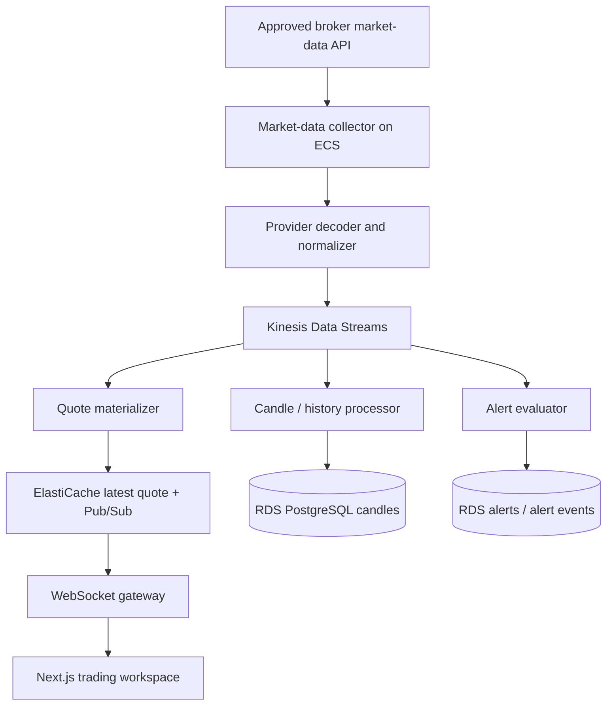
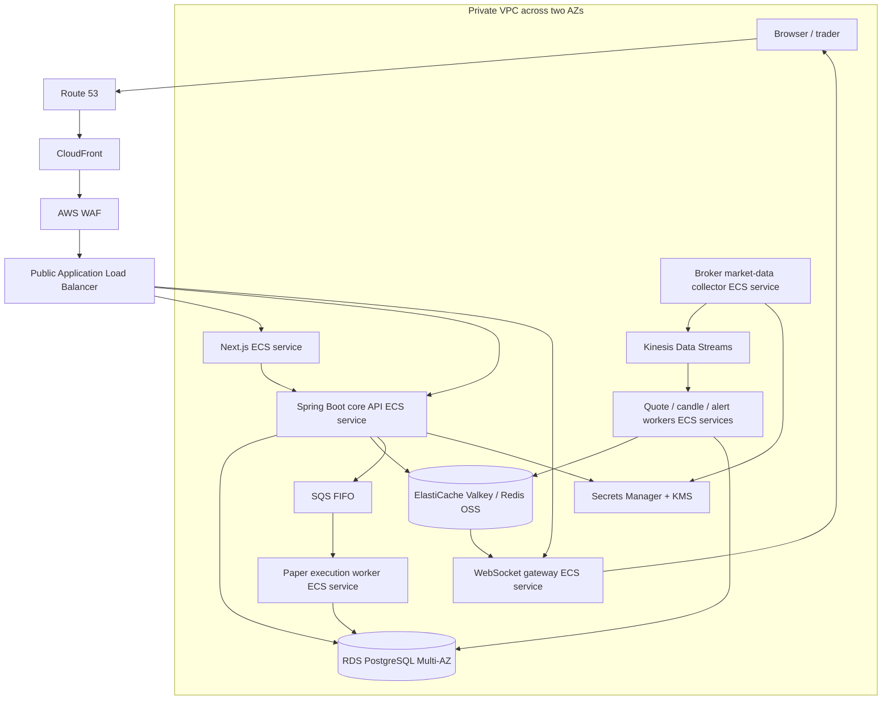
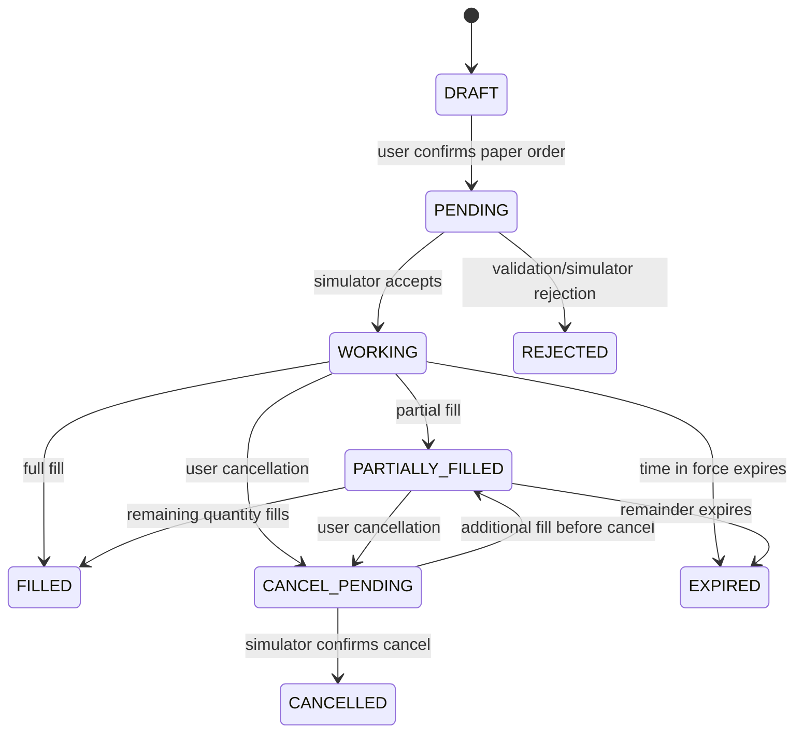
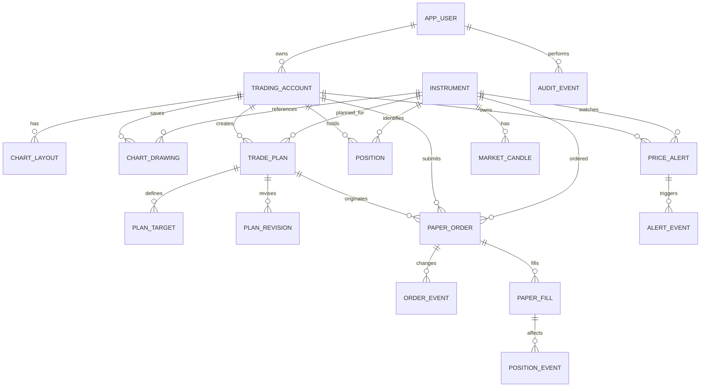

# Simply Markets — AWS Technical Blueprint

**Version:** 1.0  
**Date:** 15 November 2026  
**Status:** Architecture baseline for implementation  
**Product baseline:** `functional-spec.md` and the supplied dashboard reference image  

---

## 1. Executive summary

Simply Markets is a chart-centric trading workspace. The first release is **paper-trading only**. Users inspect candlesticks, add market-coordinate drawings, create and review explicit trade plans, submit simulated orders, and monitor simulated positions, P&L, alerts and history.

### Confirmed decisions

| Concern | Decision |
|---|---|
| Cloud | AWS, primary region `ap-south-1` (Mumbai) |
| Frontend | Next.js App Router + TypeScript |
| Backend | Java 25 LTS + Spring Boot 4.x |
| Backend architecture | Modular monolith, with independently deployed workers/gateway |
| Market data | Broker API adapter; broker and redistribution rights remain a launch gate |
| Initial scale | 1,000 registered users; performance-test 1,000 concurrent WebSocket clients |
| Transactional database | Amazon RDS for PostgreSQL, Multi-AZ |
| Cache / fan-out | Amazon ElastiCache for Valkey or Redis OSS |
| Market event stream | Amazon Kinesis Data Streams, on-demand capacity |
| Background commands | Amazon SQS FIFO for paper-order commands |
| Compute | Amazon ECS on AWS Fargate |
| Edge / ingress | Route 53, CloudFront, AWS WAF, Application Load Balancer |
| Identity | Amazon Cognito User Pool, OAuth 2.0 authorization code + PKCE |
| Secrets / encryption | AWS Secrets Manager + AWS KMS |
| CI/CD / IaC | GitHub Actions using OIDC, ECR, ECS, Terraform |
| Execution mode | Paper only; no live broker order placement in the MVP |

### Architecture principles

1. PostgreSQL is the source of truth for plans, orders, fills, positions, account state and audit history.
2. Market ticks are not financial transactions. Keep high-frequency ticks out of the transactional database.
3. Live quotes are ephemeral cache state; a quote cache miss must not fabricate a price.
4. A plan activation never submits an order. Order submission requires a separate user confirmation.
5. The paper engine must report a fill only after its simulator has emitted and persisted a fill result.
6. Every order submission is idempotent and every state transition is auditable.
7. Paper and future live modes must be isolated by account/mode boundaries. The MVP exposes paper mode only.
8. The market-data adapter is provider-neutral. Do not make frontend or domain services depend on a broker's proprietary payload format.

---

## 2. Scope and assumptions

### 2.1 Included in MVP

- User authentication and profile.
- Paper trading account creation and account-scoped data.
- Instrument search/selection and instrument master.
- Candlestick chart with OHLC readout, crosshair, zoom, pan and common intervals.
- EMA 20 and EMA 50 overlays.
- Chart drawings: horizontal price line, trend line, Entry, Stop, Target 1..N and text note.
- Create, edit, save, duplicate, activate, pause, resume, complete and archive trade plans.
- Directional/risk validation and risk/reward preview.
- Explicitly confirmed paper orders, order lifecycle and simulated fills.
- Open orders, positions, trade history, realized/unrealized P&L and alerts.
- WebSocket quote and user-activity updates.
- Market-data freshness, delay and connection status.
- Admin/operations views for feed health, instrument imports and simulator configuration.

### 2.2 Excluded from MVP

- Live broker order placement, modification, cancellation or exit.
- Automatic trigger-to-order execution.
- Arbitrary user scripts or strategy bots.
- Multi-leg options strategies.
- Advanced backtesting, social trading, tax reports and accounting exports.
- Claims that simulated fills represent executable exchange prices.

### 2.3 Scope assumptions requiring product sign-off

- Instrument metadata is modelled generically, including exchange, asset class, tick size, lot size, expiry, strike, option right and multiplier. Instruments are enabled only when required metadata is complete and validated.
- Single-leg derivative instruments may be enabled only after correct contract-master, lot-size, multiplier, expiry and tick-size data is sourced. Multi-leg strategies remain excluded.
- The market-data provider is not selected by name. A provider contract and its permitted use must be approved before shared live data is shown to customers.
- “1,000 users” is treated as 1,000 registered users, with a load-test target of 1,000 simultaneous WebSocket connections. Registered users and concurrent users are different sizing inputs.
- Initial paper fill policy must be explicitly versioned and published in product settings. Recommended first policy: quote-based simulation when valid bid/ask is available; otherwise use a documented, conservative last-trade/candle rule. Never claim tick-accurate execution when the feed does not support it.

---

## 3. Market-data broker decision: mandatory launch gate

The application will implement a `BrokerMarketDataAdapter` interface and provider-specific connectors. However, broker API access is not automatically a licence to distribute market data to a platform's entire customer base or retain it for historical charting.

### 3.1 Concrete provider warning

Zerodha's published Kite Connect terms state that live market data obtained through Kite Connect cannot be displayed to the public at large and restrict use of the API/live data for virtual or mock trading applications. Its documentation describes up to 3,000 instruments per WebSocket connection and up to three WebSocket connections per API key. Those are technical limits, not a redistribution licence.

Upstox's Market Data Feed V3 documents a WebSocket feed, Protobuf payloads, and per-user connection/subscription limits. Those technical limits do not, by themselves, establish rights to redistribute a shared feed to Simply Markets customers.

**Decision:** Do not use a pooled personal broker credential to feed 1,000 customers. Before enabling a production shared feed, obtain written approval from the selected broker/data owner that expressly covers:

- display to the intended Simply Markets users;
- paper/virtual trading use;
- number and type of end users;
- instruments, market segments and depth level;
- simultaneous connections and throughput;
- historical candle retrieval, storage and retention;
- caching, aggregation, derived indicators and alert evaluation;
- delayed versus real-time display and required source attribution;
- audit, privacy, security, expiry and termination requirements.

If the selected broker only permits per-customer use, implement each customer's OAuth-authorized connector and enforce data isolation/entitlements. That is not equivalent to permission for the platform to redistribute one customer's feed to others. Do not enable an app-wide shared feed until written terms allow it.

### 3.2 Data adapter boundary

```java
public interface BrokerMarketDataAdapter {
    ProviderId providerId();
    ConnectionResult connect(FeedCredentials credentials);
    void subscribe(Set<ProviderInstrumentKey> instruments, FeedMode mode);
    void unsubscribe(Set<ProviderInstrumentKey> instruments);
    void disconnect();
    FeedHealth health();
}

public interface MarketDataNormalizer {
    NormalizedQuote normalize(ProviderMessage message, InstrumentMapping mapping);
    NormalizedCandle normalize(ProviderCandle candle, InstrumentMapping mapping);
}
```

Provider-specific code owns authentication, WebSocket reconnect, binary/Protobuf decoding, subscription limits and provider error handling. Domain services consume only normalized events.

### 3.3 Feed processing flow



Kinesis partition key: canonical `instrument_id`, preserving order for updates to the same instrument within the shard. Use on-demand capacity initially. Measure producer/consumer lag and hot instrument partitions. Do not archive raw ticks to S3 or retain them in Kinesis beyond the provider agreement. Persist only the permitted derived bars/fields.

### 3.4 Feed correctness rules

- Store provider event time, exchange event time (when supplied), collector receive time and browser display time separately.
- Maintain a feed-health state per provider and market segment.
- A reconnect must trigger subscription restoration and a permitted snapshot/backfill process.
- Detect sequence gaps where the provider exposes sequence information; otherwise mark data quality as best-effort.
- Never convert a missing quote to zero or silently keep showing it as current.
- Mark quote state stale after a configurable threshold based on instrument activity and market status.
- Apply UI update coalescing (for example, 100–250 ms per instrument) without discarding the provider timestamp or claiming a lower latency than measured.
- Provider rate limits and per-account connection/subscription caps are configuration, not constants buried in business code.

---

## 4. Target AWS deployment architecture

### 4.1 Region and availability

- Primary region: AWS Mumbai `ap-south-1`.
- VPC spans at least two Availability Zones.
- Public subnets: internet-facing ALB and NAT Gateway egress.
- Private application subnets: ECS Fargate services.
- Isolated data subnets: RDS PostgreSQL and ElastiCache.
- Use VPC endpoints for supported AWS services (for example, S3, ECR, CloudWatch Logs, Secrets Manager and KMS) where cost and service support make sense.
- Use a single AWS region for MVP. Define backup/restore procedures before promising multi-region disaster recovery.

### 4.2 Logical deployment diagram



### 4.3 AWS service inventory

| Layer | AWS service | Configuration / responsibility |
|---|---|---|
| DNS | Route 53 | `app`, `api`, `stream` subdomains; health-checked records as appropriate |
| CDN | CloudFront | Cache immutable Next static assets; do not cache authenticated API or WebSocket responses |
| Edge security | AWS WAF | Managed rule groups, rate-based rules, IP reputation rules and application-specific allow/deny rules |
| TLS | AWS Certificate Manager | TLS certificates for CloudFront and ALB hostnames |
| Ingress | Application Load Balancer | HTTPS path/host routing to Next.js, API and WebSocket target groups |
| Web frontend | ECS Fargate | Next.js Node runtime, at least two tasks across AZs |
| Core backend | ECS Fargate | Spring Boot modular monolith, at least two tasks across AZs |
| Market connector | ECS Fargate | Long-lived broker WebSocket connection; one active connector per approved feed plus lease/failover design |
| Stream workers | ECS Fargate | Kinesis consumers for quote materialization, candles and alerts |
| WebSocket | ECS Fargate | Authenticated persistent client connections; scale using active connection and outbound message metrics |
| Paper execution | ECS Fargate | SQS FIFO consumer; idempotent simulation and fill processing |
| Transaction DB | RDS PostgreSQL | Multi-AZ deployment, encryption, private DB subnets, PITR backups |
| Cache | ElastiCache Valkey or Redis OSS | Latest quote state, Pub/Sub, ephemeral caches; Multi-AZ/replica where available |
| Market stream | Kinesis Data Streams | On-demand; instrument partition key; retention only as permitted |
| Order queue | SQS FIFO | Ordered paper order commands by account; DLQ and redrive controls |
| Notifications | SNS / SES (optional) | Email or operational notifications; in-app alerts remain core product data |
| Identity | Cognito User Pool | OAuth 2.0 authorization code + PKCE, MFA and account recovery |
| Secrets | Secrets Manager | Broker app credentials, DB credentials, signing/credential material |
| Encryption | KMS | RDS, S3, Secrets Manager and application envelope encryption keys |
| Object storage | S3 | Static artifacts, permitted exports and backups; no raw market archive without rights |
| Observability | CloudWatch + OpenTelemetry | Logs, metrics, traces and alarms |
| Container registry | ECR | Immutable, scanned application images |
| IaC | Terraform | VPC, ECS, ALB, RDS, Redis, Kinesis, SQS, IAM and WAF |

### 4.4 DNS and routing

Recommended public hostnames:

- `app.simplymarkets.example` — CloudFront → Next.js ECS service.
- `api.simplymarkets.example` — ALB → Spring Boot API.
- `stream.simplymarkets.example` — ALB → WebSocket gateway.

Use CloudFront for frontend assets and appropriate public pages. Keep `/api` calls uncached and disable caching for authenticated responses. WebSocket traffic should use a dedicated hostname and ALB target group; verify idle timeout, connection draining and reconnect behaviour in load tests. Do not route long-lived WebSocket connections through a caching behaviour.

### 4.5 ECS service baseline

| ECS service | Initial desired capacity | Scaling signal |
|---|---:|---|
| Next.js web | 2 tasks | CPU, memory, request count and p95 render latency |
| Core API | 2 tasks | CPU, memory, ALB request count and p95 latency |
| WebSocket gateway | 2 tasks | Active sockets per task, outbound bytes/messages, memory and event-loop/worker saturation |
| Broker collector | 1 active task | Feed health, disconnect count, receive lag; single-active lease if standby is deployed |
| Kinesis workers | 1–2 tasks per consumer group | Iterator age / consumer lag and CPU |
| Paper execution worker | 1–2 tasks | SQS oldest-message age, queue depth, processing latency |

These are starting counts, not final capacity commitments. Run a workload test with 1,000 concurrent WebSocket connections and representative instrument subscriptions before production launch. If a provider only grants a limited number of upstream connections, scale downstream fan-out independently without exceeding those upstream limits.

### 4.6 Database and cache configuration

- RDS PostgreSQL in private DB subnets, Multi-AZ, encryption with KMS, automated backups and point-in-time recovery.
- Use RDS Proxy if application connection churn or serverless/short-lived clients justify it. For stable ECS workloads, use a bounded HikariCP pool per task and size the aggregate pool below the DB connection budget.
- ElastiCache Valkey/Redis OSS in private subnets, TLS in transit and encryption at rest where supported. Use a replication group/Multi-AZ failover topology appropriate to the selected engine and region availability.
- Redis is a cache and fan-out mechanism, not the authoritative order/position database.
- Kinesis stores market events transiently for stream processing; its retention must respect feed terms. Do not treat a Kinesis stream as a legal entitlement to store data.

---

## 5. Frontend architecture — Next.js

### 5.1 Application approach

Use the current supported Next.js App Router release, TypeScript, React Server Components for shell/public content, and Client Components for the interactive trading workspace. Build the application as a Docker container using Next.js `output: "standalone"` and run it on ECS Fargate.

The chart is an interactive client-side island. Do not server-render a chart canvas. Server-render the workspace shell, instrument metadata and non-interactive summaries where useful; hydrate the chart workspace and WebSocket client in the browser.

### 5.2 Frontend structure

```text
apps/web/
  app/
    (public)/
      page.tsx
      learning/
    (authenticated)/
      trading/page.tsx
      paper-trading/page.tsx
      investing/page.tsx
      account/page.tsx
    api/                         # small BFF/auth callbacks only
  src/
    features/
      market-watch/
      chart-workspace/
      chart-drawings/
      trade-plans/
      paper-orders/
      positions/
      alerts/
      activity/
    shared/
      api-client/
      auth/
      components/
      hooks/
      schemas/
      state/
      utils/
```

### 5.3 Frontend libraries

| Concern | Recommendation |
|---|---|
| UI | Tailwind CSS + shadcn/ui |
| Charts | TradingView Lightweight Charts, after licence/attribution review |
| Client state | Zustand for transient UI/workspace state |
| Server state | TanStack Query for cache, invalidation and REST lifecycle |
| Validation | Zod for form/request shape validation (server still validates independently) |
| Forms | React Hook Form + Zod |
| Tables | TanStack Table |
| Testing | Playwright, Vitest and React Testing Library |

### 5.4 Chart-state rules

- Persist drawings using market coordinates: timestamp and price, not pixel coordinates.
- Keep drawing geometry separate from chart-library runtime objects.
- Use a stable canonical `instrument_id` and interval ID in layouts/drawings.
- Crosshair inspection must distinguish a selected historical candle from the current quote.
- A drawing is not a plan; a plan can exist without a visible drawing.
- Linked plan labels update when the plan level changes. Deleting a drawing must not delete the plan.
- Save active tool, visible range, indicator settings and layout preferences per user.
- Undo/redo is client-side for the current edit session; persisted revisions are server-side.

---

## 6. Backend architecture — Spring Boot modular monolith

### 6.1 Deployable units

1. `simply-markets-core-api`: modular Spring Boot application containing user/account, instruments, chart metadata, drawings, plans, paper order API, positions, alerts and audit modules.
2. `market-data-collector`: connects to the approved broker feed, decodes provider payloads and writes normalized events to Kinesis.
3. `market-data-workers`: Kinesis consumers for quote materialization, candle processing and alert evaluation. These can start as one process with separate consumer groups if throughput allows.
4. `websocket-gateway`: serves browser connections and consumes latest quote/user events from Redis Pub/Sub or a dedicated event channel.
5. `paper-execution-worker`: consumes SQS FIFO order commands and persists simulator outcomes.

Do not split every domain module into a microservice. Keep transactionally related business rules within the core API until independent scaling or release cadence proves separation is necessary.

### 6.2 Core modules and ownership

| Module | Owns | Must not own |
|---|---|---|
| Identity adapter | Cognito subject mapping, user status, roles | Password storage |
| Account | Paper account lifecycle, ownership and mode | Broker order execution |
| Instrument | Canonical instrument master, exchange/contract metadata | Provider raw payload formats |
| Market data | Normalized quotes, candle query contracts, feed status | Financial orders/positions |
| Chart | Layouts, drawings and chart preferences | Chart rendering pixel state |
| Trade plan | Plan lifecycle, targets, risk validation and revisions | Automatic order submission on activation |
| Order management | Paper order intent/state, idempotency and events | Exchange routing |
| Paper execution | Fill simulation and simulator configuration | Real broker order placement |
| Portfolio | Simulated positions, realized/unrealized P&L | Inventing missing/stale marks |
| Alert | User alert rules and notification state | Submitting orders |
| Audit | Append-only business/security audit records | Mutable business state |

### 6.3 Internal domain events

Use versioned event envelopes. Example:

```json
{
  "eventId": "uuid",
  "eventType": "paper.order.submitted.v1",
  "aggregateType": "paper_order",
  "aggregateId": "uuid",
  "accountId": "uuid",
  "occurredAt": "2026-11-15T07:30:00Z",
  "schemaVersion": 1,
  "correlationId": "uuid",
  "payload": {
    "instrumentId": "uuid",
    "side": "BUY",
    "quantity": "10",
    "orderType": "LIMIT",
    "limitPrice": "245.50"
  }
}
```

Store an outbox row in the same PostgreSQL transaction as the business change. A publisher sends committed outbox events to SQS/Kinesis. Consumers are idempotent; assume at-least-once delivery. Do not claim exactly-once business execution based only on queue semantics.

### 6.4 Order state machine



Keep plan state independent of order and position state. A plan may be Active while an order is Working; an open position may remain after a plan is Completed or Archived.

### 6.5 Paper execution rules

- Order submit creates an order intent and an outbox event in one DB transaction.
- `Idempotency-Key` is unique per account/user scope and is persisted with the request hash and final response.
- SQS FIFO `MessageGroupId` should be the paper account ID to serialize commands for the same account. Use a DLQ, redrive policy and alarm on oldest-message age.
- Worker locks/claims order state using optimistic versioning or row-level locking.
- Simulator returns a fill/reject/working result. Only then persist the new order state and any fills.
- A fill is immutable. Corrections are represented by compensating events, not an in-place rewrite of history.
- Position quantities and average cost are recomputed transactionally from fills, or updated using a deterministic transaction-safe position service.
- Exit orders support full or partial quantity and require confirmation.
- Repeated, delayed or out-of-order messages must not duplicate fills.
- Store a `simulator_version` and `fill_policy_id` on each order/fill so historical outcomes remain explainable after simulator changes.

#### Suggested first fill profile

Version `PAPER_V1` should be deterministic and documented. Recommended conservative rules:

- Use valid bid/ask when available and permitted: buy market fills against ask; sell market fills against bid, plus configured slippage.
- Limit buy can fill only when the eligible ask/market condition reaches or crosses the limit according to the declared model; limit sell uses the inverse condition.
- If bid/ask is not available, use a separately documented LTP/candle fallback. Do not label it as order-book simulation.
- Do not fill against stale data.
- Make partial-fill, fees, taxes and slippage settings explicit. If not modelled, show “excluded from simulated P&L” rather than zero fees as if actual.
- Never present a paper fill as an exchange execution.

---

## 7. PostgreSQL data model / ERD

### 7.1 ERD overview



### 7.2 Tables and key fields

Use UUID primary keys, `TIMESTAMPTZ` for instants, `NUMERIC` for prices/amounts/quantities where decimal precision is required, and explicit enums or validated text values for statuses. Avoid floating-point types for money or instrument prices.

#### `app_user`

- `id UUID PK`
- `cognito_sub VARCHAR(128) UNIQUE NOT NULL`
- `email CITEXT UNIQUE NOT NULL`
- `display_name VARCHAR(120)`
- `status VARCHAR(24) NOT NULL`
- `created_at`, `updated_at TIMESTAMPTZ NOT NULL`

#### `trading_account`

- `id UUID PK`
- `user_id UUID FK app_user`
- `name VARCHAR(80)`
- `account_mode VARCHAR(12) CHECK (account_mode = 'PAPER')`
- `base_currency CHAR(3) DEFAULT 'INR'`
- `initial_cash NUMERIC(20,4) NOT NULL`
- `available_cash NUMERIC(20,4) NOT NULL`
- `status VARCHAR(20) NOT NULL`
- `created_at`, `updated_at`

#### `instrument`

- `id UUID PK`
- `provider_id VARCHAR(40)` (nullable/provider mapping only; not identity)
- `provider_instrument_key VARCHAR(160)`
- `exchange VARCHAR(16) NOT NULL`
- `segment VARCHAR(24) NOT NULL`
- `symbol VARCHAR(80) NOT NULL`
- `display_name VARCHAR(160)`
- `asset_class VARCHAR(24) NOT NULL`
- `currency CHAR(3) DEFAULT 'INR'`
- `tick_size NUMERIC(20,8) NOT NULL`
- `lot_size NUMERIC(20,8) NOT NULL`
- `contract_multiplier NUMERIC(20,8) NOT NULL DEFAULT 1`
- `expiry_date DATE`, `strike_price NUMERIC(20,8)`, `option_right VARCHAR(4)`
- `is_tradeable BOOLEAN NOT NULL`, `metadata_version VARCHAR(32)`
- `created_at`, `updated_at`

Unique constraints: `(exchange, segment, symbol, expiry_date, strike_price, option_right)` where applicable; unique provider mapping `(provider_id, provider_instrument_key)` where non-null.

#### `market_candle`

- `instrument_id UUID FK instrument`
- `interval_code VARCHAR(8)` (for example `1m`, `5m`, `15m`, `1h`, `1d`)
- `candle_start TIMESTAMPTZ NOT NULL`
- `open`, `high`, `low`, `close NUMERIC(20,8) NOT NULL`
- `volume NUMERIC(24,4)`
- `source_id VARCHAR(40)`, `quality_status VARCHAR(20)`
- `created_at TIMESTAMPTZ`

Primary key `(instrument_id, interval_code, candle_start)`. Partition by time when volume justifies it. Enforce `high >= greatest(open, close, low)` and `low <= least(open, close, high)` as validation/constraint logic. Store only data permitted by the provider agreement.

#### `chart_layout`

- `id UUID PK`, `account_id UUID FK`, `name VARCHAR(100)`
- `instrument_id UUID FK`, `interval_code VARCHAR(8)`
- `visible_range JSONB`, `indicator_config JSONB`, `preferences JSONB`
- `is_default BOOLEAN`, `version BIGINT`, `created_at`, `updated_at`

#### `chart_drawing`

- `id UUID PK`, `account_id UUID FK`, `instrument_id UUID FK`
- `chart_layout_id UUID FK NULL`, `plan_id UUID NULL`
- `drawing_type VARCHAR(24)`
- `points JSONB NOT NULL` (price + exchange timestamp market coordinates)
- `label VARCHAR(80)`, `style JSONB`, `is_visible BOOLEAN`
- `created_at`, `updated_at`, `version BIGINT`

Do not store chart screen pixel coordinates as the durable geometry.

#### `trade_plan`

- `id UUID PK`, `account_id UUID FK`, `instrument_id UUID FK`
- `name VARCHAR(120)`, `side VARCHAR(5) CHECK (side IN ('LONG','SHORT'))`
- `entry_type VARCHAR(24)`, `entry_price NUMERIC(20,8)` nullable
- `stop_price NUMERIC(20,8) NOT NULL`
- `sizing_method VARCHAR(24)`, `quantity NUMERIC(20,8)`, `risk_budget NUMERIC(20,4)`
- `status VARCHAR(24) NOT NULL`, `notes TEXT`
- `revision BIGINT NOT NULL DEFAULT 1`, `activated_at TIMESTAMPTZ`
- `created_at`, `updated_at`, `archived_at`

Directional checks: Long plan stop below entry and target above entry; inverse for Short. Validate server-side and use instrument tick/lot rules. Store risk calculation inputs and formula version, not only a rendered ratio.

#### `plan_target`

- `id UUID PK`, `plan_id UUID FK`, `target_number SMALLINT`
- `target_price NUMERIC(20,8)`, `quantity_percent NUMERIC(7,4)` nullable
- `created_at`, `updated_at`
- Unique `(plan_id, target_number)`.

#### `plan_revision`

- `id UUID PK`, `plan_id UUID FK`, `revision BIGINT`
- `snapshot JSONB NOT NULL`, `changed_by UUID FK app_user`
- `change_reason TEXT`, `created_at`
- Unique `(plan_id, revision)`; append-only.

#### `paper_order`

- `id UUID PK`, `account_id UUID FK`, `instrument_id UUID FK`, `plan_id UUID FK NULL`
- `side VARCHAR(5)`, `order_type VARCHAR(16)`, `time_in_force VARCHAR(12)`
- `quantity NUMERIC(20,8)`, `limit_price NUMERIC(20,8) NULL`, `trigger_price NUMERIC(20,8) NULL`
- `filled_quantity NUMERIC(20,8) NOT NULL DEFAULT 0`
- `status VARCHAR(24) NOT NULL`
- `idempotency_key VARCHAR(128) NOT NULL`, `request_hash VARCHAR(128) NOT NULL`
- `simulator_version VARCHAR(32)`, `fill_policy_id VARCHAR(32)`
- `submitted_at`, `updated_at`, `completed_at`
- Unique `(account_id, idempotency_key)`.

#### `order_event`

- `id UUID PK`, `order_id UUID FK`, `event_type VARCHAR(32)`
- `previous_status VARCHAR(24)`, `new_status VARCHAR(24)`
- `payload JSONB`, `correlation_id UUID`, `occurred_at TIMESTAMPTZ`
- Append-only. Index `(order_id, occurred_at)`.

#### `paper_fill`

- `id UUID PK`, `order_id UUID FK`, `account_id UUID FK`, `instrument_id UUID FK`
- `fill_quantity NUMERIC(20,8) NOT NULL`, `fill_price NUMERIC(20,8) NOT NULL`
- `fees NUMERIC(20,4) NOT NULL`, `slippage NUMERIC(20,8)`
- `market_data_event_time TIMESTAMPTZ`, `simulated_at TIMESTAMPTZ NOT NULL`
- `simulator_version VARCHAR(32)`, `fill_policy_id VARCHAR(32)`
- Unique simulator event/fill reference to prevent duplicate fill application.

#### `position`

- `id UUID PK`, `account_id UUID FK`, `instrument_id UUID FK`
- `net_quantity NUMERIC(20,8) NOT NULL`, `average_entry_price NUMERIC(20,8)`
- `mark_price NUMERIC(20,8)`, `realized_pnl NUMERIC(20,4) NOT NULL DEFAULT 0`
- `unrealized_pnl NUMERIC(20,4)`, `currency CHAR(3)`
- `status VARCHAR(16)`, `version BIGINT`, `opened_at`, `updated_at`, `closed_at`
- Unique active net position `(account_id, instrument_id)` where status is OPEN.

#### `position_event`

- `id UUID PK`, `position_id UUID FK`, `fill_id UUID FK NULL`
- `event_type VARCHAR(24)`, `quantity_delta NUMERIC(20,8)`
- `price NUMERIC(20,8)`, `realized_pnl_delta NUMERIC(20,4)`
- `payload JSONB`, `occurred_at TIMESTAMPTZ`

#### `price_alert` and `alert_event`

`price_alert`: `id`, `account_id`, `instrument_id`, optional `plan_id`, `condition_type`, `trigger_price`, `status`, `last_evaluated_at`, `triggered_at`, `created_at`, `updated_at`.  
`alert_event`: `id`, `alert_id`, `event_type`, `observed_price`, `observed_market_time`, `occurred_at`, `delivery_state`, `payload`.

#### `outbox_event`

- `id UUID PK`, `aggregate_type`, `aggregate_id`, `event_type`, `payload JSONB`
- `created_at`, `published_at`, `attempt_count`, `next_attempt_at`, `last_error`
- Index unpublished events by `(published_at, next_attempt_at)`.

#### `audit_event`

- `id UUID PK`, `actor_user_id UUID`, `account_id UUID`, `action VARCHAR(80)`
- `resource_type`, `resource_id`, `request_id`, `ip_hash`/approved security metadata
- `before_state JSONB`, `after_state JSONB`, `occurred_at`
- Append-only, restricted write permissions and retention policy.

### 7.3 Indexes and data management

- `paper_order(account_id, status, submitted_at DESC)`.
- `paper_fill(account_id, simulated_at DESC)` and `paper_fill(order_id, simulated_at)`.
- `position(account_id, status)`.
- `trade_plan(account_id, status, updated_at DESC)`.
- `chart_drawing(account_id, instrument_id, updated_at DESC)`.
- `price_alert(account_id, status, instrument_id)`.
- `market_candle(instrument_id, interval_code, candle_start DESC)` via the primary key.
- `order_event(order_id, occurred_at)`.
- `audit_event(actor_user_id, occurred_at DESC)` and `(resource_type, resource_id)`.
- Use keyset/cursor pagination for activity feeds; avoid deep `OFFSET` pagination.
- Apply retention/partitioning to candles, order events and audit events according to product, provider and legal retention rules.
- Add PostgreSQL row-level ownership checks in application queries; optionally apply RLS as defence in depth. Never rely on frontend account IDs for authorization.

---

## 8. REST API contract

Base path: `/v1`. Use JSON, UTC ISO-8601 timestamps and decimal values serialized as strings in monetary/price fields to avoid JavaScript floating-point corruption.

### 8.1 API conventions

- Auth: validated Cognito identity; API authorizes every account/resource access server-side.
- Mutating requests: `Idempotency-Key` header for order submission and other non-repeatable commands.
- Concurrency: `If-Match`/resource version on plan/layout updates; return `409 Conflict` on stale updates.
- Errors: `application/problem+json` with stable `code`, `detail`, `traceId` and field errors.
- Pagination: `limit` + opaque `cursor`.
- All list endpoints scope by authenticated user/account; never trust a caller-supplied user ID.

### 8.2 Identity and accounts

| Method | Endpoint | Purpose |
|---|---|---|
| GET | `/v1/me` | Current user profile and entitlements |
| GET | `/v1/accounts` | List current user's paper accounts |
| POST | `/v1/accounts` | Create paper account |
| GET | `/v1/accounts/{accountId}` | Account summary |
| PATCH | `/v1/accounts/{accountId}` | Rename/configure permitted account settings |

### 8.3 Instruments and market data

| Method | Endpoint | Purpose |
|---|---|---|
| GET | `/v1/instruments?query=&exchange=&assetClass=` | Instrument search |
| GET | `/v1/instruments/{instrumentId}` | Contract metadata |
| GET | `/v1/market/candles?instrumentId=&interval=&from=&to=` | Historical candles |
| GET | `/v1/market/quotes?instrumentIds=` | Latest quote snapshot for bounded set |
| GET | `/v1/market/status` | Exchange session and provider/feed status |
| POST | `/v1/market/stream-ticket` | Issue short-lived, single-use WebSocket ticket |

Candle response includes `source`, `exchangeTime`, `receivedAt`, `isDelayed`, `isStale` and data-quality status. The current quote must not be presented as the selected historical candle close.

### 8.4 Chart layouts and drawings

| Method | Endpoint | Purpose |
|---|---|---|
| GET | `/v1/chart/layouts` | List layouts |
| POST | `/v1/chart/layouts` | Create layout |
| GET | `/v1/chart/layouts/{layoutId}` | Get layout |
| PATCH | `/v1/chart/layouts/{layoutId}` | Update settings with version check |
| DELETE | `/v1/chart/layouts/{layoutId}` | Delete layout |
| GET | `/v1/drawings?instrumentId=&layoutId=` | List drawings |
| POST | `/v1/drawings` | Create drawing |
| PATCH | `/v1/drawings/{drawingId}` | Move/edit drawing |
| DELETE | `/v1/drawings/{drawingId}` | Delete drawing only; linked plan remains |

### 8.5 Trade plans

| Method | Endpoint | Purpose |
|---|---|---|
| GET | `/v1/plans?status=&cursor=` | List plans |
| POST | `/v1/plans` | Create draft |
| GET | `/v1/plans/{planId}` | Plan detail + targets + latest revision |
| PATCH | `/v1/plans/{planId}` | Update draft/eligible plan |
| POST | `/v1/plans/{planId}/duplicate` | Duplicate plan as a new draft |
| POST | `/v1/plans/{planId}/activate` | Activate only; never submits an order |
| POST | `/v1/plans/{planId}/pause` | Pause monitoring |
| POST | `/v1/plans/{planId}/resume` | Resume plan |
| POST | `/v1/plans/{planId}/complete` | Complete plan |
| POST | `/v1/plans/{planId}/archive` | Archive plan |
| POST | `/v1/plans/validate` | Validate levels and calculate risk/reward preview |

Validation response should include directional validation, tick/lot validation, risk per unit, planned total risk, target rewards, risk/reward, sizing warnings, and `canActivate` with field-level reasons.

### 8.6 Paper orders, positions and history

| Method | Endpoint | Purpose |
|---|---|---|
| POST | `/v1/paper/orders` | Submit a confirmed paper order |
| GET | `/v1/paper/orders?status=&cursor=` | Open/recent paper orders |
| GET | `/v1/paper/orders/{orderId}` | Order + events + fills |
| POST | `/v1/paper/orders/{orderId}/cancel` | Cancel eligible working order |
| PATCH | `/v1/paper/orders/{orderId}` | Modify eligible working order |
| GET | `/v1/paper/positions` | Open positions and marks |
| POST | `/v1/paper/positions/{positionId}/exit` | Submit confirmed full/partial exit order |
| GET | `/v1/paper/trades?cursor=` | Fills, exits and realized P&L |
| GET | `/v1/paper/summary` | Running/day P&L and position summary |

Order submission example:

```http
POST /v1/paper/orders
Idempotency-Key: 3c1b...
Content-Type: application/json
```

```json
{
  "accountId": "uuid",
  "instrumentId": "uuid",
  "planId": "uuid",
  "side": "BUY",
  "orderType": "LIMIT",
  "quantity": "10",
  "limitPrice": "245.50",
  "timeInForce": "DAY",
  "confirmation": {
    "executionMode": "PAPER",
    "acceptedFillPolicyId": "PAPER_V1"
  }
}
```

Initial response is an acknowledgement such as `PENDING` or `WORKING`, not a fabricated fill. The final response may be fetched from the order resource or received through WebSocket.

### 8.7 Alerts and operations

| Method | Endpoint | Purpose |
|---|---|---|
| GET | `/v1/alerts` | List alerts |
| POST | `/v1/alerts` | Create alert from a plan or price level |
| PATCH | `/v1/alerts/{alertId}` | Update/pause alert |
| DELETE | `/v1/alerts/{alertId}` | Delete alert |
| GET | `/v1/alerts/events` | Trigger history |
| GET | `/v1/admin/feed-health` | Restricted provider health view |
| GET | `/v1/admin/simulator-config` | Restricted simulator configuration |
| PATCH | `/v1/admin/simulator-config` | Versioned simulator config change |

Admin endpoints require a separate role and should be inaccessible to normal users.

---

## 9. WebSocket contract

### 9.1 Connection lifecycle

1. Browser authenticates through the Next.js session.
2. Browser requests `POST /v1/market/stream-ticket` through the authenticated backend/BFF.
3. Server returns a random, single-use ticket with a short TTL (for example, 30 seconds), bound to user, account, allowed channels and a nonce.
4. Browser connects to `wss://stream.simplymarkets.example/ws` and sends the ticket via an agreed WebSocket subprotocol or equivalent protected handshake mechanism. Do not place long-lived Cognito/broker tokens in query strings.
5. Gateway atomically consumes the ticket, validates account scope and connection limits, then sends `ready`.
6. On reconnect, obtain a new ticket and re-subscribe. The browser must reconcile authoritative order/position state over REST after reconnect.

### 9.2 Client messages

```json
{"type":"subscribe","requestId":"uuid","channels":[{"name":"quotes","instrumentIds":["uuid1","uuid2"]},{"name":"candles","instrumentId":"uuid1","interval":"1m"},{"name":"orders"},{"name":"positions"},{"name":"alerts"}]}
```

```json
{"type":"unsubscribe","requestId":"uuid","channels":[{"name":"quotes","instrumentIds":["uuid2"]}]}
```

### 9.3 Server messages

```json
{"type":"ready","connectionId":"uuid","serverTime":"2026-11-15T07:30:00Z"}
```

```json
{
  "type":"quote",
  "instrumentId":"uuid",
  "lastPrice":"245.50",
  "bid":"245.45",
  "ask":"245.55",
  "exchangeTime":"2026-11-15T07:30:00Z",
  "receivedAt":"2026-11-15T07:30:00.120Z",
  "source":"BROKER_FEED",
  "isDelayed":false,
  "isStale":false
}
```

Other event types:

- `candle.updated`
- `market.status`
- `feed.status`
- `plan.updated`
- `order.updated`
- `fill.created`
- `position.updated`
- `alert.triggered`
- `server.warning`
- `subscription.ack`
- `subscription.error`

### 9.4 WebSocket safety and scale

- Enforce per-user/per-connection instrument and channel caps.
- Validate that requested instruments and account channels are entitled to the user.
- Limit inbound message size, subscription churn and message frequency.
- Heartbeat/ping-pong and idle disconnect behaviour must be explicit.
- Use bounded outbound queues; drop/coalesce superseded quote messages instead of allowing an unbounded slow-client backlog. Never drop order/fill/alert state silently; clients can reconcile those events through REST.
- Do not broadcast account-specific order/position data through a market-wide topic.
- Gateway must support reconnect with exponential backoff and jitter.
- Measure active connections, messages/sec, outbound bytes, queue depth and per-task memory.

---

## 10. Security architecture

### 10.1 Identity and session

- Cognito User Pool with OAuth 2.0 authorization code grant + PKCE.
- MFA for users; stronger step-up authentication for sensitive account/security changes.
- Use short-lived access tokens and refresh/session rotation.
- Prefer an opaque Secure, HttpOnly, SameSite cookie backed by a server-side session for the browser. Avoid exposing broker credentials or long-lived refresh tokens to JavaScript.
- Next.js acts as a thin BFF/session boundary where needed; it must not contain trading rules or be the source of truth. Spring Boot validates identity/claims and enforces authorization.
- Verify JWT signature, issuer, audience/client ID, expiry and intended token use against Cognito JWKS.

### 10.2 Authorization

Roles: `USER`, `SUPPORT_READ_ONLY`, `OPERATIONS`, `ADMIN`. Add account-level ownership checks to every resource query and command. Support users should not receive trading privileges by default. Admin actions must be audited and step-up protected.

### 10.3 Secrets and encryption

- Store app-level broker client secret, DB credentials and signing material in Secrets Manager.
- Use KMS-managed encryption for RDS, S3, Secrets Manager and supported cache encryption.
- If customer-specific broker tokens are ever introduced, encrypt them using envelope encryption and a KMS key; restrict decryption to the broker connector role. Never put tokens in browser storage, logs, analytics or error traces.
- TLS end-to-end at the edge and between services where supported; use TLS to PostgreSQL and Redis.
- Rotate secrets and record rotation failures as alerts.

### 10.4 Network and IAM

- No public IP on ECS tasks, RDS or ElastiCache.
- ALB is the only public application ingress.
- Egress from market collector is restricted to approved provider endpoints where practical; use NAT Gateway with fixed Elastic IP if broker network allowlisting requires it.
- Use distinct IAM task roles per service. Follow least privilege: collector can read only feed secrets and write to its Kinesis stream; API can read/write required DB/cache/queue resources; paper worker can consume its queue and write order/position tables through the application DB role.
- Use security groups with service-to-service access only on required ports.
- Use VPC endpoints for supported AWS APIs and reduce unnecessary public egress.

### 10.5 Application security

- Validate input on the server; frontend validation is only UX.
- Use parameterized SQL/JPA, strict CORS allowlist, secure headers, CSP, CSRF protection for cookie-authenticated mutations, request body limits and rate limits.
- Protect against IDOR by resolving account ownership from authenticated principal, not request-supplied user IDs.
- Avoid logging secrets, tokens, raw broker payloads containing personal data or full account data.
- Apply dependency/container scanning, SAST, DAST and secret scanning in CI.
- Use OWASP ASVS as the application security verification baseline.
- Maintain an incident response and credential compromise process before production.

### 10.6 Regulatory and operating boundary

The MVP does not place live orders, provide automated execution or represent itself as a broker. Before adding live trading, obtain securities counsel and broker/exchange guidance on applicable SEBI/exchange requirements, retail API/algo framework, vendor approvals, empanelment, static IP, order tagging, audit and kill-switch obligations. A paper-only product must not be presented as live execution.

---

## 11. Observability and reliability

### 11.1 Correlation

Propagate `traceId`, `requestId`, `correlationId`, `accountId` (internal UUID only) and `orderId` through HTTP, outbox, SQS, Kinesis consumer logs and WebSocket messages. Redact email, tokens and other personal information from structured logs.

### 11.2 Metrics and alarms

| Area | Metrics | Alarm examples |
|---|---|---|
| API | request rate, p50/p95/p99, 4xx/5xx, JVM heap/GC, DB pool saturation | sustained 5xx, p95 latency, pool exhaustion |
| Market collector | connected state, last tick age, reconnects, decode errors, received ticks/sec | no ticks during expected market session, reconnect storm |
| Kinesis | iterator age, throttles, write/read errors, consumer lag | consumer lag beyond threshold, throttling |
| Redis | memory, evictions, connections, CPU, replication lag | high memory/evictions or failover |
| WebSocket | active connections, disconnects, messages/sec, outbound queue depth | connection cap, growing queues, elevated disconnects |
| Paper engine | SQS depth, oldest message age, processing duration, failures, DLQ count | oldest order command age, DLQ > 0 |
| PostgreSQL | CPU, storage, connections, locks, deadlocks, replica/failover status | storage threshold, connection saturation, failover |
| Frontend | SSR errors, hydration errors, web vitals, JS errors | sustained SSR errors or critical client errors |

### 11.3 Provisional service objectives

Treat these as launch targets to validate, not guarantees:

- Core REST reads/writes p95 below 300 ms under the agreed test workload, excluding historical chart ranges and third-party provider latency.
- Backend market event to WebSocket gateway publish p95 below 150 ms after ingestion; browser rendering and upstream broker latency are measured separately.
- No duplicate paper fills under repeated submission, worker retry, timeout or redelivery tests.
- 1,000 concurrent WebSocket sessions sustained during a market-session load test.
- Quote freshness is visible and stale feeds are marked; never silently fall back to stale values as current.
- Initial availability objective: 99.5% monthly for MVP. Increase only after runbooks, failover tests and on-call coverage mature.

### 11.4 Failure behaviour

- Broker disconnect: show stale status; reconnect with backoff; restore subscriptions; backfill only where allowed; do not use stale quote for new paper fills.
- Kinesis lag: alert, scale consumers, retain event processing checkpoint; if provider retention/policy permits, replay from retained stream.
- Redis unavailable: API still returns plans/orders from PostgreSQL; latest quote UI becomes unavailable/stale; do not claim live updates.
- SQS failure: persist order intent/outbox; surface pending state; retry publication idempotently; never tell user order filled until worker commits it.
- RDS failover: reconnect pool, retry safe reads and idempotent commands; reconcile outbox and queue state after recovery.
- WebSocket disconnect: reconnect, reauthenticate and perform REST reconciliation for orders/positions/alerts.

---

## 12. CI/CD, infrastructure and environments

### 12.1 Environments

- `dev`: developer integration, synthetic or replay feed only.
- `staging`: production-like configuration, provider sandbox or explicitly authorized non-production feed.
- `prod`: approved live market-data source; paper-only user execution.

Separate AWS accounts are preferred for production and non-production. If the team initially uses one account, enforce distinct VPCs/stacks, IAM boundaries, KMS keys and resource naming; migrate to separate accounts before customer scale.

### 12.2 Pipeline

```mermaid
flowchart LR
  A[Pull request] --> B[Format + lint]
  B --> C[Unit + module tests]
  C --> D[Testcontainers integration tests]
  D --> E[SAST + dependency + secret scans]
  E --> F[Build Docker images]
  F --> G[Push signed image to ECR]
  G --> H[Deploy staging ECS]
  H --> I[Smoke + Playwright + load/synthetic checks]
  I --> J[Manual production approval]
  J --> K[Rolling or blue/green ECS deployment]
  K --> L[Health verification / rollback]
```



Use GitHub Actions OIDC federation to assume a narrowly scoped AWS deployment role; do not store long-lived AWS access keys in GitHub Secrets. Promote immutable image digests from staging to production.

### 12.3 Terraform modules

```text
infra/terraform/
  modules/
    vpc/
    security-groups/
    alb-cloudfront-waf/
    ecs-cluster/
    ecs-service/
    rds-postgres/
    elasticache/
    kinesis/
    sqs/
    cognito/
    secrets-kms/
    observability/
  environments/
    dev/
    staging/
    prod/
```

Terraform state should be remote in a dedicated S3 backend with state locking, versioning, encryption and restricted access. Use plan review and apply approval for production.

---

## 13. Repository structure

```text
simply-markets/
  apps/
    web/                          # Next.js App Router
    admin-web/                    # optional later; do not block MVP
  services/
    core-api/                     # Spring Boot modular monolith
    market-data-collector/        # provider adapter + decoder + Kinesis producer
    market-data-workers/          # quotes, candles, alerts consumers
    websocket-gateway/            # client sessions + fan-out
    paper-execution-worker/       # SQS FIFO consumer + simulator
  libs/
    market-data-contracts/        # schemas and event contracts
    api-contracts/                # OpenAPI specs/generated clients
    test-fixtures/
  infra/
    terraform/
    docker/
  docs/
    architecture/
    api/
    runbooks/
```

Within `core-api`, use package-by-feature/module rather than technical-layer package sprawl:

```text
com.simplymarkets
  identity/
  account/
  instrument/
  marketdata/
  chart/
  drawing/
  tradeplan/
  paporder/
  portfolio/
  alert/
  audit/
  shared/
```

Each module exposes an application interface and owns its persistence model. Avoid cross-module table writes. Use internal application events for module interactions and outbox events for asynchronous boundaries.

---

## 14. Testing strategy and acceptance mapping

### 14.1 Required test layers

- Unit tests: risk calculations, tick/lot validation, state machines, P&L, simulator fill rules and alert evaluation.
- Module integration: PostgreSQL migrations, optimistic locking, outbox consistency, ownership checks and transaction boundaries.
- Contract tests: broker adapter decoder against recorded/synthetic fixtures permitted by provider, Kinesis event schemas, REST OpenAPI and WebSocket event versions.
- Deterministic replay: replay a known market event sequence and assert candles, alerts and simulator decisions.
- End-to-end: Playwright tests for chart loading, drawing edits, plan creation, validation, activation, paper order, cancellation, exit and history.
- Load: 1,000 WebSocket clients, instrument subscription churn, quote fan-out, chart history reads and order bursts.
- Resilience: broker disconnect/reconnect, duplicate tick, out-of-order tick, Kinesis lag, Redis failover, SQS redelivery, DLQ, RDS failover and deployment rollback.
- Security: IDOR/account isolation, cookie/session handling, CSRF, XSS, CORS, rate-limit bypass, secret scanning and dependency vulnerabilities.

### 14.2 Acceptance mapping to functional specification

| Functional acceptance | Implementation/test |
|---|---|
| Instrument + interval + OHLC + EMA | Instrument API, candle API, chart client; Playwright chart test |
| Drawings persist in market coordinates | `chart_drawing`; pan/zoom/reload integration test |
| Plan fields synchronize with chart levels | Trade-plan API + plan overlay state; bidirectional UI test |
| Risk/reward and directional constraints | Server validation service; unit and API tests |
| Plan activation does not submit order | Plan state transition test asserts no order row/outbox command |
| Paper order confirmation and honest status | Order API + SQS FIFO worker; no premature fill test |
| Simulated fill updates position/P&L | Fill transaction integration test and deterministic replay |
| Cancel and partial/full exit | State-machine and concurrency tests |
| Alert can navigate to linked plan/chart | Alert API + WebSocket + deep-link UI test |
| Paper mode/stale data visible | UI contract tests and feed disconnect E2E |

---

## 15. Delivery milestones

| Milestone | Deliverables | Exit criteria |
|---|---|---|
| 0. Provider/commercial gate | Select broker; review API terms; obtain written data-use/redistribution approval or define permitted per-user connection model | Product/legal approval recorded; allowed instruments, users, history and cache rules documented |
| 1. AWS foundation | Accounts/environments, VPC, ALB, ECS, RDS, Redis, Cognito, Secrets, CloudWatch, Terraform, CI/CD | Repeatable dev/stage deploy; security baseline and rollback tested |
| 2. Core platform | Next.js shell, Cognito flow, Spring modular API, accounts, instrument master | Authenticated user can open a paper account and search instruments |
| 3. Chart foundation | Broker adapter behind feature gate, candle/quote contract, chart, EMA, feed freshness, drawings | Candles load; drawing anchors survive pan/zoom/reload; stale states visible |
| 4. Trade planning | Plan editor, target list, chart/editor synchronization, validation, risk/reward, revisions | Draft/activate/pause/archive flows pass acceptance tests; activation never submits order |
| 5. Paper execution | SQS FIFO, outbox, simulator, orders, fills, positions, P&L, cancel/exit | Duplicate submission/redelivery cannot duplicate fills; fill rules published |
| 6. Live workspace updates | WebSocket tickets, gateway, quote/order/position/alert events, reconnect and reconciliation | 1,000 concurrent WebSocket test passes; no account data leakage |
| 7. Production hardening | WAF, security tests, backup restore, failover, dashboards, runbooks, UAT | UAT acceptance met; operational owner and incident runbooks assigned |

### Suggested sequence within milestones

1. Chart foundation: instruments, candles, chart interactions, indicators, drawings and persistence.
2. Plan workflow: editor, level synchronization, risk preview, validation and lifecycle.
3. Paper execution: confirmation, simulator, order lifecycle, positions, P&L and activity.
4. Hardening: responsive/accessibility, stale-feed states, audit, performance and failover.
5. Live brokerage: separate future project requiring provider selection, authorization, order lifecycle, reconciliation and regulatory review.

---

## 16. Operational runbooks required before launch

- Broker feed disconnected / authentication expired / subscription rejected.
- Data delayed or stale during market hours.
- Kinesis consumer lag or poison message.
- Redis failover or memory pressure.
- Paper order stuck in Pending/Working.
- SQS DLQ message investigation and safe redrive.
- Position/P&L mismatch and reconciliation.
- PostgreSQL failover, restore and point-in-time recovery.
- Cognito compromise, session revocation and secret rotation.
- ECS deployment failure and rollback.
- WebSocket gateway overload and reconnect storm.
- Market holiday/special session/instrument expiry configuration.

Support and operations tools must never silently edit or erase financial event history. Corrections should be append-only and explainable.

---

## 17. Key risks and decisions still open

| Risk / decision | Why it matters | Required action |
|---|---|---|
| Broker feed redistribution and mock-use rights | Broker technical API access may not authorize public display or paper trading | Written broker approval before production shared feed |
| Broker selection | Connection limits, payload formats, tokens, entitlement and costs differ | Evaluate candidate API and contract terms with representative load test |
| Historical candle entitlement | Real-time access does not automatically permit long-term storage or redistribution of history | Document permitted history, caching and retention per interval/instrument |
| Instrument scope | Options require expiry, tick, lot and multiplier data | Confirm asset classes for MVP; gate any incomplete contracts |
| Fill model | LTP-only feed is not an order book and cannot support realistic queue simulation | Publish versioned simulator methodology and UI disclosure |
| Data delay and freshness SLA | Users must know whether quotes are delayed/stale | Define provider SLA and server-side thresholds |
| Market calendar | Trading session cannot be inferred from a screenshot | Load maintained exchange calendar and special sessions |
| 1,000 users vs active concurrency | Registered account count does not set WebSocket capacity | Load-test 1,000 concurrent sessions and realistic subscriptions |
| Live trading future | Changes regulatory and operational obligations | Treat as a separate phase with broker/exchange/legal review |

---

## 18. Reference documentation

The following references informed the architecture. Provider policies and cloud service capabilities should be rechecked during implementation because they can change.

### AWS and Next.js

- Amazon ECS service load-balancing guidance: https://docs.aws.amazon.com/AmazonECS/latest/developerguide/ecs_services.html
- Amazon RDS Multi-AZ concepts: https://docs.aws.amazon.com/AmazonRDS/latest/UserGuide/Concepts.MultiAZ.html
- Kinesis Data Streams overview and on-demand modes: https://aws.amazon.com/documentation-overview/kinesis-data-streams/
- ElastiCache replication: https://docs.aws.amazon.com/AmazonElastiCache/latest/dg/Replication.Redis.Groups.html
- Cognito OAuth PKCE: https://docs.aws.amazon.com/cognito/latest/developerguide/using-pkce-in-authorization-code.html
- Next.js deployment: https://nextjs.org/docs/app/getting-started/deploying
- Next.js self-hosting: https://nextjs.org/docs/app/guides/self-hosting

### Broker and market data

- Zerodha Kite Connect terms: https://kite.trade/terms/
- Zerodha WebSocket documentation: https://kite.trade/docs/connect/v3/websocket/
- Zerodha API FAQ: https://support.zerodha.com/category/trading-and-markets/general-kite/kite-api/articles/kite-connect-api-faqs
- Upstox Market Data Feed V3: https://upstox.com/developer/api-documentation/v3/get-market-data-feed/
- Upstox authentication: https://upstox.com/developer/api-documentation/authentication/
- NSE Data Sharing & Usage Policy: https://betanseapi.nseindia.com/static/market-data/nse-data-policy

### India regulatory context for any later API/algo/live trading phase

- SEBI retail algorithmic trading circular, 4 February 2025: https://www.sebi.gov.in/legal/circulars/feb-2025/safer-participation-of-retail-investors-in-algorithmic-trading_91614.html
- SEBI implementation timeline extension, 30 September 2025: https://www.sebi.gov.in/legal/circulars/sep-2025/extension-of-timeline-for-implementation-of-sebi-circular-dated-february-04-2025-on-safer-participation-of-retail-investors-in-algorithmic-trading-_96979.html
- NSE empanelled algo providers and related updates: https://www.nseindia.in/static/trade/empanelled-algo-providers-exchange

---

## 19. Final architecture recommendation

Build Simply Markets as a **Next.js application + Spring Boot modular monolith**, with separate ECS services only for the broker feed collector, market-data workers, WebSocket gateway and paper execution worker. Use PostgreSQL for all authoritative business state, Redis for current quote/cache/fan-out state, Kinesis for market-event processing, and SQS FIFO plus an outbox for paper order commands.

Do not add EKS, Kafka/MSK, ClickHouse, a live broker order adapter or autonomous trading at MVP. Add them only when measurable product or scale requirements justify them. The first production release is ready only when the selected broker's paper-trading and market-data display rights are documented, the paper fill model is transparent, the order state machine passes retry/concurrency tests, and the 1,000-client WebSocket load test and database recovery drill pass.
